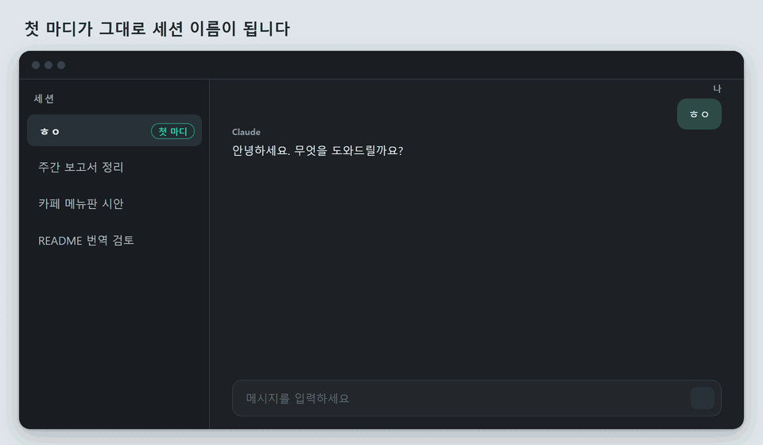

# session-namer

[English](README.md) · 한국어

**Claude 데스크톱 앱 사이드바의 세션 이름을 대화 주제에 맞게 바꿔 주는 Claude Code 모드입니다. 모델을 따로 부르지 않습니다.**



Claude 데스크톱 앱(Code 탭) 사이드바에서 세션 이름이 "ㅎㅇ"처럼 첫 마디 그대로 굳어 버린 경우가 있습니다. 이 모드는 그런 이름을 대화 주제에 맞게 바꿔 줍니다. 위 그림은 동작을 설명하려고 그린 예시 화면이며, 실제 앱 화면이 아닙니다.

## 동작 방식

- 사용자가 메시지를 보낼 때마다 앱 도구 `get_session`으로 지금 이름을 확인합니다. 도구 호출이라 모델 토큰은 들지 않습니다.
- 이름이 첫 마디 그대로이거나 세 글자 이하면, 그 메시지에 짧은 안내(한국어 150자 안팎, 영어 300자 안팎)를 붙입니다.
  - "ㅎㅇ", "ㅇㅋ"처럼 네 글자 이하인 메시지에는 주제가 없으므로 붙이지 않습니다.
- Claude는 원래 쓰던 답 맨 앞에 `<!-- session-title: … -->` 한 줄을 넣습니다. 모드는 저장되는 답에서 그 줄을 지우고 `set_session_title`로 이름을 바꿉니다. 바뀌면 알림이 뜹니다.
- 모델을 따로 부르지 않습니다. 보통 세션 하나에 안내 한 번(한국어 130토큰 안팎)과 이름 줄 하나(15토큰 안팎)가 듭니다. 이름이 처음부터 멀쩡한 세션에서는 0입니다.
- 이름을 지은 뒤 메시지가 30개 지나면, 대화가 다른 일로 넘어갔는지 한 번 더 봅니다. 간격은 설정에서 바꿀 수 있고 0으로 두면 다시 보지 않습니다.
- 이름은 대화 언어에 맞춰 한국어나 영어로 짓습니다(설정 `language`).
- 다음 경우에는 아무것도 하지 않습니다.
  - 사람이 직접 바꾼 이름이 보이면 그 세션에서는 꺼집니다.
  - 예약 작업 세션은 건너뜁니다.
  - 다른 세션이 보낸 메시지에는 반응하지 않습니다.

## 비슷한 도구와 다른 점

자동으로 세션 이름을 짓는 도구는 이미 여럿 있습니다. 2026년 11월에 확인한 차이는 이렇습니다.

| | 이 모드 | CLI용 도구([sorrycc/session-namer](https://github.com/sorrycc/session-namer), [sathwick-p/claude-rename](https://github.com/sathwick-p/claude-rename)) | [Shepherd-Creative gist](https://gist.github.com/Shepherd-Creative/4b723ba2261292a58bcc931aff7c0b3e) |
| --- | --- | --- | --- |
| 이름이 보이는 곳 | 데스크톱 앱 사이드바 | `claude --resume` 목록 | 데스크톱 앱 사이드바 |
| 이름 짓는 법 | Claude가 원래 쓰는 답에 숨은 한 줄 | `claude -p`로 모델을 한 번 더 부름(Haiku·Sonnet) | git 저장소·브랜치 이름으로 만들고, Claude가 도구를 한 번 더 부름 |
| 주제가 바뀌면 | 다시 지음(30메시지마다 확인) | sorrycc는 5턴마다, claude-rename은 한 번만 | 다시 짓지 않음(처음 이름 고정) |

데스크톱 사이드바 이름이 바뀌는 건 실제 데스크톱 세션에서 확인했습니다. 사람이 직접 바꾼 이름은 건드리지 않습니다.

Claude Code 2.1.308부터는 훅의 `sessionTitle`로 돌려준 이름도 로컬 데스크톱 세션 사이드바에 반영된다는 보고가 있습니다([anthropics/claude-code#104473](https://github.com/anthropics/claude-code/issues/104473)). 그전에는 터미널 쪽만 바뀌었습니다.

## 필요한 것

- Claude 데스크톱 앱의 Code 탭이 필요합니다. 앱 도구(`ccd_session_mgmt`)가 없는 곳, 예를 들어 터미널 CLI에서는 스스로 꺼집니다.
- hooks 모듈 모드를 돌릴 수 있는 Claude Code여야 합니다. 2.1.330에서 확인했습니다.

## 설치

데스크톱 앱에서는 프롬프트 옆 + → Plugins → Add marketplace를 누르고 `etehofk1-ops/desktop-session-namer`를 넣은 뒤 Add plugin을 누릅니다.

터미널에서는 이렇게 설치합니다.

```
/plugin install session-namer --marketplace etehofk1-ops/desktop-session-namer
```

## 명령

| 명령 | 하는 일 |
| --- | --- |
| `/session-name` | 상태, 지금 판정, 최근 기록 보기 |
| `/session-name now` | 다음 메시지에서 이름을 한 번 새로 짓게 하기 |
| `/session-name off` | 이 세션에서 끄기 |
| `/session-name on` | 다시 켜기(지금 이름을 새 기준으로 삼음) |

## 설정

| 항목 | 기본값 | 뜻 |
| --- | --- | --- |
| `recheckEvery` | 30 | 이름을 지은 뒤 몇 메시지마다 다시 볼지 정합니다. 0이면 다시 보지 않습니다. |
| `language` | `auto` | 이름 언어입니다. `auto`는 보낸 메시지에 한글이 있으면 한국어, 없으면 영어로 짓습니다. `ko`·`en`으로 고정할 수 있습니다. |

## 한계

- 답이 화면에 흘러나오는 동안 이름 줄이 잠깐 보이는지는 확인하지 못했습니다. 저장되는 답에서는 지워집니다.
- Claude가 안내를 따르지 않으면 이름이 바뀌지 않습니다. 그 경우 다음 메시지에 안내가 다시 붙습니다.
- 데스크톱 앱의 `ccd_session_mgmt` 도구(`get_session`, `set_session_title`)에 기대어 동작합니다. 공개 문서가 없는 내부 도구라 앱 업데이트로 바뀔 수 있습니다. 도구가 동작하지 않으면 그 세션에서 모드가 스스로 꺼집니다.

## 시험

```
claude plugin test .
```

## 라이선스

MIT
