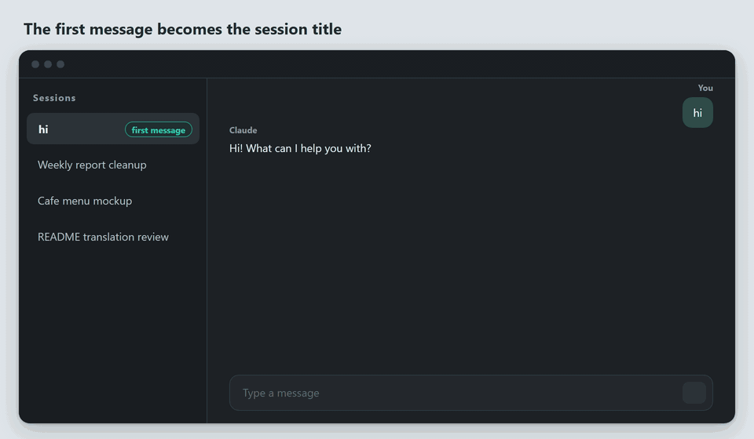

# session-namer

English · [한국어](README.ko.md)

**A Claude Code mod that renames sessions in the Claude desktop app's sidebar to match what the conversation is about, so you never have to name a session yourself. Each title costs one small Haiku call, about $0.00002–0.00023.**



In the Claude desktop app (Code tab), a session's sidebar title often stays stuck on your first message, like "hi". This mod renames it to the topic of the conversation. The animation above is an illustration of how it works, not a screenshot of the real app.

## How it works

- Each time you send a message, the mod reads the current title with the app's own `get_session` tool. That is a tool call, so it costs no model tokens.
- If the title is just your first message, or three characters or shorter, the mod waits for Claude's reply to finish.
  - Messages of four characters or fewer, like "hi" or "ok", have no topic, so they are skipped.
- When the reply finishes, the mod sends Haiku the first 1,000 characters of your message and the first 800 characters of the reply in one low-effort call, and asks for a title. It renames the session with the app's `set_session_title` tool. A toast tells you the new title.
- Nothing is added to your conversation. Claude never sees a hint and never writes a hidden line.
- After it names a session, the mod asks Haiku again every 30 messages whether the conversation has moved on to something else. Haiku answers KEEP unless the topic changed. You can change the interval, or set it to 0 to turn this off.
- Titles follow the language of the conversation, English or Korean (setting `language`).
- The mod stays out of the way when:
  - you have renamed the session yourself (it turns itself off for that session),
  - the session is a scheduled task,
  - the message came from another session rather than from you.

## What it costs

Measured on November 25, 2026 with Claude Code 2.1.325 (`claude -p`) and Haiku 5.5. The mod's own naming requests were sent through the same call the mod uses (`$.model.complete`). Costs use Haiku 5.5 list prices: $0.10 per million input tokens and $0.50 per million output tokens.

| Case | Input tokens | Output tokens | Cost per call |
| --- | --- | --- | --- |
| First title, short English chat | 183 | 9 | about $0.00002 |
| First title, short Korean chat | 282 | 18 | about $0.00004 |
| Recheck, short Korean chat | 343 | 18 | about $0.00004 |
| First title, long Korean chat (excerpts at their limit) | 2,126 | 21–30 | about $0.00023 |

- A call takes about 0.9 seconds. It runs after the reply has finished, so you never wait for it.
- The excerpts are capped, so one call stays at about $0.00023 or less however long the conversation gets.
- Most sessions need a single call. A 100-message session needs four (one title and three rechecks), which is still under $0.001.
- The call goes through your session's own Claude Code login, so no API key is needed. It counts toward the session's cost total like any other request.
- Before 0.5.0, the conversation's own model wrote the title as a hidden line in its reply. At the same list prices that came to about $0.0006 (Sonnet 5.5) to $0.0021 (Fable 5.2) per title, so the Haiku call is roughly 3 to 57 times cheaper.

## How it differs from similar tools

Several tools already name sessions automatically. This is how they compare (checked November 2026).

| | This mod | CLI namers ([sorrycc/session-namer](https://github.com/sorrycc/session-namer), [sathwick-p/claude-rename](https://github.com/sathwick-p/claude-rename)) | [Shepherd-Creative gist](https://gist.github.com/Shepherd-Creative/4b723ba2261292a58bcc931aff7c0b3e) |
| --- | --- | --- | --- |
| Where the title shows | Desktop app sidebar | `claude --resume` list | Desktop app sidebar |
| How the title is made | One Haiku call from inside the session, after the reply | A separate `claude -p` call (Haiku or Sonnet) | Built from the git repo and branch; Claude makes one extra tool call |
| Renames when the topic changes | Yes, checks every 30 messages | sorrycc every 5 turns; claude-rename names once | No, the name stays fixed |

Renaming in the desktop sidebar has been checked in a real desktop session (0.5.0, November 2026). A title you set yourself is never overwritten.

Since Claude Code 2.1.308, a title returned in a hook's `sessionTitle` field is reported to reach the sidebar of local desktop sessions too ([anthropics/claude-code#104473](https://github.com/anthropics/claude-code/issues/104473)). Before that it only changed the terminal side.

## Requirements

- The Claude desktop app's Code tab. Where the app's tools (`ccd_session_mgmt`) are not available, such as the terminal CLI, the mod turns itself off.
- A Claude Code build that runs hooks-module mods. Tested on 2.1.330.

## Install

In the desktop app: click + next to the prompt box, then Plugins → Add marketplace, enter `etehofk1-ops/desktop-session-namer`, then Add plugin.

In a terminal:

```
/plugin install session-namer --marketplace etehofk1-ops/desktop-session-namer
```

## Commands

You don't need any of these for normal use.

| Command | What it does |
| --- | --- |
| `/session-name` | Show the status, the current verdict, Haiku calls and tokens used in this session, and recent activity |
| `/session-name now` | Name the session again right away from the latest exchange |
| `/session-name off` | Turn it off for this session |
| `/session-name on` | Turn it back on (the current title becomes the new baseline) |

## Settings

| Setting | Default | Meaning |
| --- | --- | --- |
| `recheckEvery` | 30 | How many messages after naming before it checks the title again. 0 turns rechecking off. |
| `language` | `auto` | Title language. `auto` uses Korean if your message contains Hangul and English otherwise. Set `en` or `ko` to fix it. |

## Limitations

- Haiku sees only the latest exchange: the first 1,000 characters of your last message and the first 800 of the reply. A recheck that lands on a short detour may rename the session after the detour.
- The title changes when the reply finishes, so a long task gets its title when it ends.
- If a reply is stopped or ends in an error, nothing is named on that turn. The mod tries again after your next message.
- If the Haiku call fails three times in a row, the mod turns itself off for that session. `/session-name on` turns it back on.
- The mod relies on the desktop app's `ccd_session_mgmt` tools (`get_session`, `set_session_title`). They are undocumented and may change in any app update. If they stop working, the mod turns itself off for that session.

## Tests

```
claude plugin test .
```

## License

MIT
